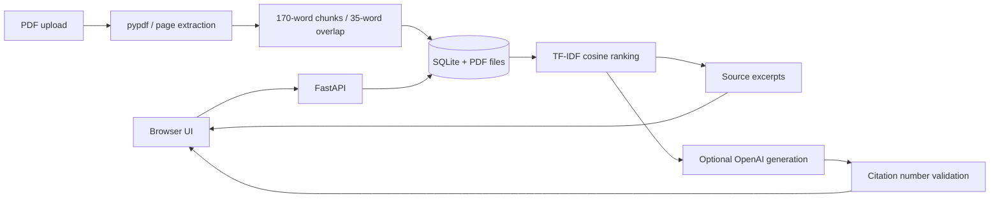

# Kaynak AI

[](https://github.com/berkayozdmr21/kaynak-ai/actions/workflows/ci.yml)

**Belgeden bilgiye, kaynağıyla.**

**Türkçe ve İngilizce PDF’ler için kaynaklı araştırma asistanı.** PDF yükleyin, belge seçin, soru sorun ve yanıtın dayandığı sayfaları açın.

Bu repo çalışan bir portföy MVP’sidir: FastAPI backend, responsive HTML/CSS/JavaScript frontend, SQLite depolama, TF-IDF arama, isteğe bağlı OpenAI yanıt üretimi, testler ve değerlendirme betiği içerir. Özel model eğitimi veya embedding tabanlı anlamsal arama içermez.

## Hızlı başlangıç

**Windows:** Projeyi indirip bir klasöre çıkarın ve `BASLAT.cmd` dosyasına çift tıklayın. Python kurulu olmalıdır. İlk çalıştırmada bağımlılıklar indirilir. Başlatıcı boş bir port seçer, sunucunun hazır olduğunu doğrular ve tarayıcıyı otomatik açar. Siteyi kullanırken terminal penceresini açık tutun. Başlatma hataları `baslatma.log` dosyasına yazılır.

Python 3.10+ önerilir. Proje klasöründe:

```powershell
python -m venv .venv
.\.venv\Scripts\Activate.ps1
python -m pip install -r requirements.txt
python -m uvicorn backend.main:app --host 127.0.0.1 --port 8000
```

macOS/Linux aktivasyon: `source .venv/bin/activate`.

Tarayıcıda http://localhost:8000 adresini açın. **Örnek belgelerle dene** düğmesine basıp “RAG nasıl çalışır?” sorusunu sorun. PDF yüklemek için sol paneli kullanın. API belgeleri: http://localhost:8000/docs.

## Model ile yanıt üretimi

API anahtarı olmadan uygulama ilgili metinleri doğrudan alıntılar; bu mod üretilmiş bir AI özeti olarak sunulmaz. Gerçek dil modeli yanıtları için sunucuyu başlatmadan önce:

```powershell
$env:OPENAI_API_KEY="kendi-anahtarin"
$env:OPENAI_MODEL="gpt-4.1-mini"
python -m uvicorn backend.main:app --host 127.0.0.1 --port 8000
```

Hesabınızın erişebildiği uyumlu bir model adını kullanabilirsiniz. Anahtar yalnızca backend tarafından okunur. `.env.example` örnektir; uygulama `.env` dosyasını kendiliğinden yüklemez. Anahtarlı modda sorunuz ve bulunan en fazla beş metin parçası OpenAI API’ye gönderilir; API kullanımı ücretli olabilir. Model çağrısı başarısızsa alıntı moduna dönülür ve arayüzde belirtilir.

## Docker

```sh
docker compose up --build
```

Adres: http://localhost:8000. SQLite verisi ve PDF’ler Docker volume içinde kalır. Docker Compose için anahtarı shell ortamına veya gitignore kapsamındaki `.env` dosyasına koyabilirsiniz.

## Mimari



Arama terimleri Türkçe I/İ dönüşümleriyle normalize edilir. TF-IDF vektörleri sorgu sırasında seçili belgelerin parçalarından hesaplanır; kosinüs benzerliğiyle sıralanır. 0.08 altındaki sonuçlar elenir. Bu eşik küçük bir MVP varsayımıdır, gerçek veriyle kalibre edilmelidir. Skor doğruluk olasılığı değildir.

Model yanıtında en az bir kaynak numarası ve numaraların geçerli aralıkta olması kontrol edilir. Bu kontrol iddiaların gerçekten desteklendiğini garanti etmez; kaynakları okuyarak doğrulayın. Belge içi talimatların uygulanmaması sistem isteminde belirtilir; bu tek başına prompt injection için tam koruma değildir.

## API

| Method | Endpoint | Behavior |
|---|---|---|
| GET | `/api/health` | Model configuration and health |
| GET | `/api/documents` | Persistent document library |
| POST | `/api/documents` | Multipart PDF upload |
| DELETE | `/api/documents/{id}` | Delete document, chunks and PDF |
| GET | `/api/documents/{id}/file` | View original PDF |
| POST | `/api/demo` | Idempotent sample document |
| POST | `/api/ask` | Question, optional document_ids, generate flag |

`document_ids` verilmezse tüm belgeler aranır; boş liste verilirse hiçbir belge aranmaz. Model kullanmadan arama için `generate: false` gönderilebilir.

## Test ve değerlendirme

```sh
python -m unittest discover -s tests -v
python evaluation/evaluate.py
node --check frontend/app.js
```

Testler gerçek metin PDF yükleme, sayfa eşlemesi, filtreleme, yanıtsız soru, bozuk/boş PDF, silme ve Türkçe tokenizasyonu kapsar. Değerlendirme altı sentetik soruyla Recall@3, MRR@3 ve kaynak bulunmayan soruda kaçınmayı ölçer. Bu küçük set gerçek dünya doğruluk iddiası için yeterli değildir. CV’ye yazılacak başarı oranları için ayrı ve elle etiketlenmiş bir test seti oluşturun.

## Kapsam ve sonraki adımlar

- Tek kullanıcıya yönelik yerel MVP; kullanıcı hesabı, yetkilendirme ve rate limiting yoktur. Paylaşımlı internete açmadan önce bunlar eklenmelidir.
- Metin katmanı olan PDF’ler desteklenir. OCR, tablo yapısı çıkarımı ve görsel yorumlama yoktur. En fazla 10 MB / 300 sayfa / 1500 parça.
- Dosyalar `data/` altında saklanır; silme düğmesi metinleri ve PDF’yi kaldırır. Sohbet geçmişi saklanmaz.
- TF-IDF eş anlamlıları, çeviriyi ve Türkçe ekleri iyi çözmez. Türkçe/İngilizce belge kabul edilmesi diller arası anlamsal arama anlamına gelmez.
- Sonraki geliştirme: çok dilli embedding + pgvector, BM25 hibrit arama, reranker ve gerçek değerlendirme veri seti.
- Framework olarak React yerine sade JavaScript seçildi; tek sunucuyla kurulumu kolay ve tüm etkileşimleri incelenebilir tutar.

## Geliştirme

Kaynak kodunu klonlamak için:

```sh
git clone https://github.com/berkayozdmr21/kaynak-ai.git
cd kaynak-ai
```

`.env`, yüklenen PDF’ler, SQLite verisi, sanal ortam ve başlatma kayıtları Git dışında tutulur.

## Geliştirici

[Berkay Özdemir](https://github.com/berkayozdmr21)
